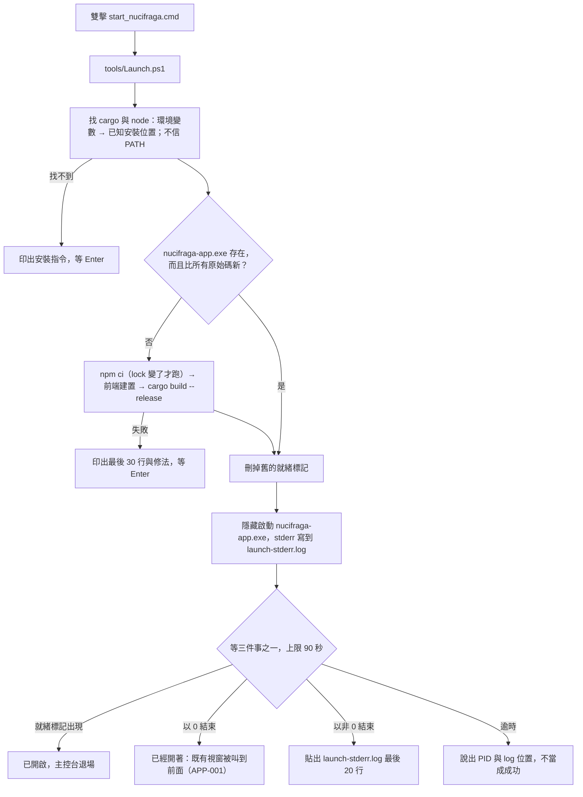

# 應用程式生命週期 —— 啟動、單一實例、關閉

**這一份是「程式怎麼開起來、怎麼結束」的權威。** 一次備份的狀態不在這裡，在 [狀態機](state-machines.md)。
依 `D:\Projects\_meta\CONVENTIONS.md` §16 的五個問題組織。

## 啟動器：`start_nucifraga.cmd` → `tools\Launch.ps1`

- **開發模式**：`tools\Launch.ps1 -Dev` 跑 `tauri dev`（前端熱更新），留在前景
- **前景除錯**：`tools\Launch.ps1 -Foreground` 直接在主控台跑 exe，錯誤全部印出來
- **第一次啟動會建置**，大約數分鐘；之後只有原始碼變了才重建

## 五個問題

### 1. 第二次啟動要做什麼？

**把既有的視窗叫到前面**，第二個行程以 0 結束。用 `tauri-plugin-single-instance`：
第二個行程把參數交給第一個，第一個 `unminimize` → `show` → `set_focus`。

### 2.「已經在跑」的判斷放哪？

**在 app 裡**（plugin 在 `main.rs` 的 builder 最前面註冊，比任何視窗都早）。啟動器不判斷，
只看行程的離開碼：0 而且沒有就緒標記 ＝ 交棒給既有實例。

識別單位是 Tauri 的 `identifier`。正式版是 `io.github.nucifraga`，`-Dev` 用 `io.github.nucifraga.dev`，
所以開發版與正式版可以同時開著，各自有各自的設定資料夾。

### 3. 啟動器憑什麼可以退場？

**就緒標記檔**：前端掛載完成、第一個畫面畫出來之後呼叫 `app_ready` 命令，
app 寫 `%LOCALAPPDATA%\<identifier>\ui-ready.txt`（內容是 PID；正式版的 identifier 是 `io.github.nucifraga`）。啟動器等的是這個檔案出現，
**不是固定秒數**。

### 4. 使用者關掉視窗之後，行程有沒有真的結束？

**有。** 單一行程、單一視窗，關掉視窗就是結束行程（Tauri 預設行為；不做系統匣常駐）。
例外只有一個，見第 5 題。

### 5. 進行中的工作變成什麼？

備份進行中按關閉 → 攔下關閉事件，顯示「備份進行中。要取消這次備份並關閉嗎？已經傳完的檔案會保留。」

- 「取消並關閉」→ 送出取消 → 等目前這個檔案做完 → `Finalizing` 寫報告 → 關閉
- 「繼續備份」→ 什麼都不做

模板編輯畫面有未儲存的修改時按關閉 → 一樣先攔下來（前端用 `set_unsaved` 告訴後端），
問「儲存並關閉／不儲存，直接關閉／繼續編輯」（ui-workflows「模板編輯」）。選了關閉才呼叫 `quit_app`。

強制結束（工作管理員、斷電）也安全：計畫是冪等的、執行鎖是作業系統的鎖、暫存檔在下一次預檢清掉
（state-machines §1「中斷之後」）。

## 檔案位置

`<identifier>` 是 `io.github.nucifraga`（開發版 `io.github.nucifraga.dev`）。資料夾由 Tauri 的 path API 給，程式裡不拼路徑。

| 東西 | 位置 |
|---|---|
| app 設定 | `%APPDATA%\<identifier>\settings.json`（只記模板資料夾在哪、外部模板的路徑） |
| 模板 | 使用者選的模板資料夾（預設 `文件\Nucifraga`）＋外部模板各自的位置 |
| 就緒標記、啟動 log | `%LOCALAPPDATA%\<identifier>\`（`ui-ready.txt`、`launch-stderr.log`） |
| 每次備份的紀錄 | 備份碟上的 `_reports\<時間>\`；備份碟找不到時寫到 `%LOCALAPPDATA%\<identifier>\reports\<時間>\` |
| app 自己的執行 log | **M1 沒有做**：每次備份的報告已經涵蓋使用者需要的紀錄；app 本身出錯時用 `tools\Launch.ps1 -Foreground` 看。要做時再訂保留期限 |
| 建置產物 | `target\release\nucifraga-app.exe`（gitignore） |
