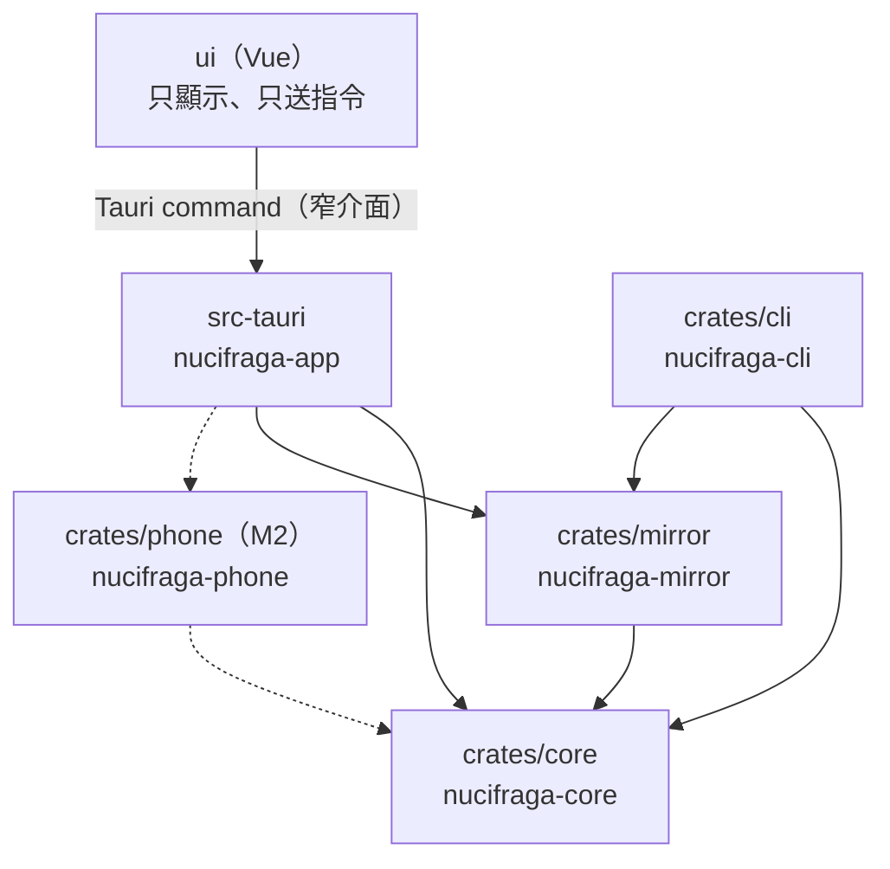
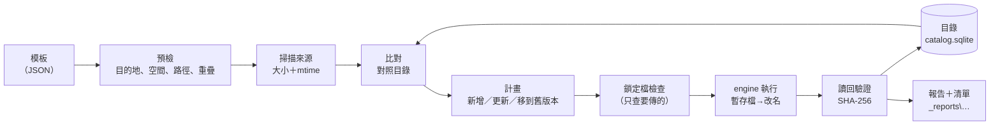

# 架構總覽

**這一份是「程式分幾層、檔案在哪、誰可以呼叫誰」的權威。**
欄位細節在 [資料模型](data-model.md)，目的地上的資料夾在 [目的地版面](storage-layout.md)，
執行的狀態在 [狀態機](state-machines.md)，錯誤在 [錯誤碼](error-codes.md)。

## 一句話

一份**模板**（來源資料夾＋排除規則＋目的地）交給**核心**，核心依序做預檢、掃描、比對、傳輸、驗證，
並寫出可以自己驗證的**清單**。桌機 UI 與命令列都只是呼叫核心的外殼。

## 分層與依賴方向



| crate | 負責 | 不可以做 |
|---|---|---|
| `nucifraga-core` | 模板讀寫、掃描、路徑預算、比對（產生計畫）、預檢、目錄（SQLite）、執行狀態機、錯誤碼、報告 | 依賴任何 engine 或 UI；直接寫目的地上的使用者檔案（那是 engine 的事） |
| `nucifraga-mirror` | 實作 `Engine`：鏡像＋版本化、暫存檔改名、讀回驗證 | 自己決定「要傳什麼」（只照計畫做）、刪除 `_versions` |
| `nucifraga-cli` | headless 執行一份模板；給工作排程器與端到端測試 | 有任何 core 沒有的邏輯 |
| `nucifraga-app` | Tauri 殼：單一實例、視窗、把 core 的事件轉給 UI | 有任何 core 沒有的邏輯；開放檔案系統給前端 |
| `ui` | 畫面、用語、使用者的選擇 | 碰檔案系統（不裝 `tauri-plugin-fs`，見 ADR-0007） |
| `nucifraga-phone`（M2） | 桌機端的手機連線：探索、配對、拉取 | — |

**依賴方向是單向的**：`nucifraga-app`／`nucifraga-cli` → `nucifraga-mirror` → `nucifraga-core`。
目錄採 Tauri 的標準形狀（`ui/` 與 `src-tauri/` 都在 repo 根），讓 Tauri CLI 的預設值直接可用。`core` 不知道有哪些 engine，engine 透過
`Engine` trait 被注入。這條邊界由 `cargo tree` 檢查守著（`tools\Verify.ps1` 的「依賴方向」一步）。

## 一次備份的資料流



兩個刻意的性質：

- **計畫是冪等的。** 每傳完一個檔案就更新目錄，所以中斷之後「續傳」就是**再跑一次**：
  已經傳完的檔案會因為目錄裡的大小與 mtime 吻合而被跳過。不需要另外一套續傳邏輯。
- **時間跟著變動量走，不跟著總量走。** 掃描只做 `stat`（不讀內容），只有大小或 mtime
  跟目錄不同的檔案才會被讀、被雜湊。見 [ADR-0005](../decisions/ADR-0005-目錄用-SQLite-而且是可重建的快取.md)。

## 檔案地圖

```
nucifraga/
├─ start_nucifraga.cmd      一鍵啟動（雙擊）
├─ Cargo.toml               Rust workspace
├─ package.json             前端相依與指令（npm ci）
├─ vite.config.ts           前端建置（root＝ui/）
├─ rust-toolchain.toml      釘住 Rust 版本
├─ crates/
│  ├─ core/                 nucifraga-core
│  ├─ mirror/               nucifraga-mirror
│  └─ cli/                  nucifraga-cli
├─ ui/                      Vue 3 + TypeScript（index.html、src/）
├─ src-tauri/               nucifraga-app（Tauri 2）
├─ examples/profiles/       範例模板（真實模板不進 repo）
├─ tools/                   Launch／Verify／圖表／agent 檔同步
└─ docs/                    本文件區
```

`android/`（Kotlin）與 `proto/`（桌機↔手機協定）在 M2 才建，見 [roadmap](../roadmap.md)。
**不先建空殼** —— 空資料夾會讓人以為那裡有東西。

## 守著邊界的檢查

| 邊界 | 誰守 |
|---|---|
| `core` 不依賴 engine／UI | `Verify.ps1`：`cargo tree -p nucifraga-core` 裡不可出現 `nucifraga-mirror`、`tauri` |
| 前端不碰檔案系統 | `Verify.ps1`「禁用 plugin」：我們的 `Cargo.toml`／`package.json` 不直接相依 fs／shell／http／updater、`src-tauri\src` 不註冊它們、capability 不授權 `fs:*` 等權限；`deny.toml` 只允許 fs 作為 dialog 的間接相依（ADR-0007） |
| 只有一個模組能寫 unsafe | workspace lint `unsafe_code = "deny"`，只有 `nucifraga_core::sys` 用 `#[allow]` 開例外 |
| 狀態機與文件一致 | `nucifraga_core::run::allowed` 的單元測試（state-machines.md「程式裡的對應」） |
| 版本下限（CVE） | `Verify.ps1`：讀 `Cargo.lock`／`package-lock.json`，比對 [versions.md](../environment/versions.md) 的表 |
| 不刪不可重生的東西 | `core` 的 `safe_delete` 是**唯一**的刪除入口，只接受「目的地根之下、已有標記檔、名稱符合格式」的路徑；單元測試覆蓋拒絕路徑 |
| repo 不含私人路徑 | `D:\Projects\_meta\scripts\Test-PublishReadiness.ps1`（公開前） |
