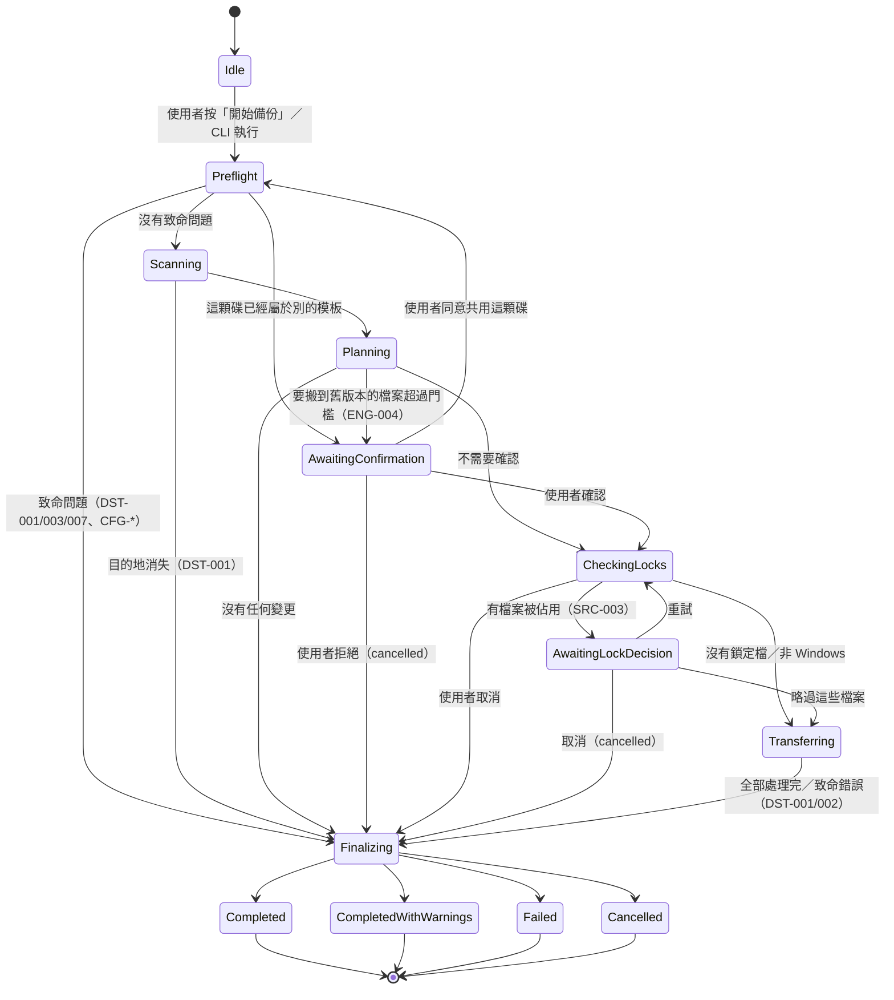
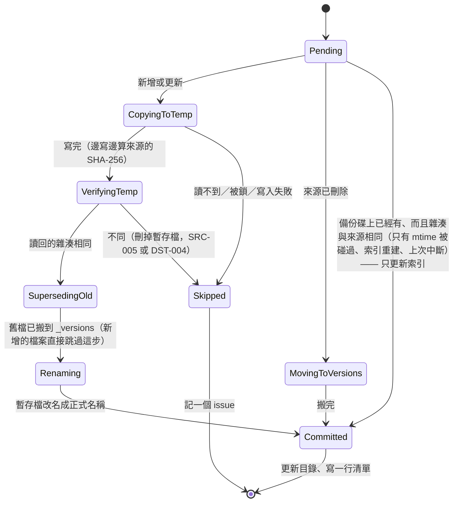
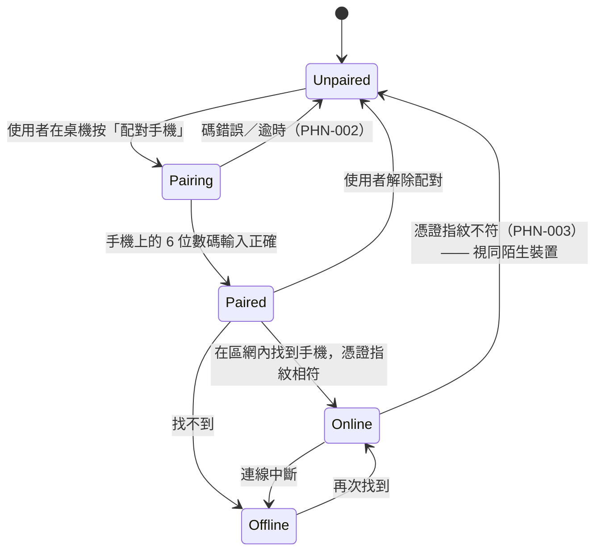

# 狀態機

**這一份是「一次備份會經過哪些狀態、什麼事件讓它轉移」的權威。**
程式裡的狀態名稱（英文）與 UI 用語（中文）的對照在 [用語表](glossary.md)；
行程本身（啟動、單一實例、關閉）不在這裡，在 [生命週期](app-lifecycle.md)。

## 1. 一次執行（`RunState`）

### 每個狀態做什麼

| 狀態 | 做什麼 | 可以取消嗎 |
|---|---|---|
| `Idle` | 什麼都沒做 | — |
| `Preflight` | 讀模板、驗模板（`CFG-*`）、目的地在不在、標記檔對不對、拿目的地的執行鎖、開目錄、清掉上次中斷留下的暫存檔 | ✅ |
| `Scanning` | 走訪每個來源，只做 `stat`；套用排除規則；記下 reparse point、雲端佔位檔 | ✅ |
| `Planning` | 對照目錄算出計畫：新增、更新、搬到舊版本、不變；算出需要的空間與路徑預算 | ✅ |
| `AwaitingConfirmation` | 等使用者表態，兩種情況：「這次會把 N 個檔案搬到舊版本」（從比對來），或「這顆碟已經是別的模板的備份碟，要共用嗎」（從預檢來，同意後回到預檢） | ✅（＝拒絕） |
| `CheckingLocks` | **只對計畫裡要讀的檔案**以共用讀取試開；打不開的用 Restart Manager 查佔用者（ADR-0009） | ✅ |
| `AwaitingLockDecision` | UI 依程式分組列出（「Outlook：3 個檔案」），等使用者選重試／略過／取消 | ✅ |
| `Transferring` | 逐檔執行計畫（見 §2）；每完成一檔就更新目錄 | ✅（做完手上這一檔才停） |
| `Finalizing` | 決定結果、寫 `report.json`／`manifest.jsonl`／`summary.txt`、放開執行鎖。**任何路徑都會經過這裡**，包括失敗與取消 —— 失敗也要留報告 | ❌ |

### 結果怎麼決定（`Finalizing`）

依序判斷，第一個成立的就是結果：

1. 使用者取消過 → `Cancelled`
2. 有致命錯誤（預檢失敗、傳輸中目的地消失、空間用完） → `Failed`
3. 有任何 `level: error` 或 `warning` 的 issue，或有略過的檔案 → `CompletedWithWarnings`
4. 否則 → `Completed`

**單一檔案出錯不會讓整次執行失敗。** 它被記成一個 issue、那個檔案略過，其餘照做。
`Failed` 只留給「繼續做下去也沒有意義」的情況。

### 沒有人可以問的時候（CLI、排程）

兩個「等使用者」的狀態在 headless 模式下有固定的答案，**往安全的那一邊**：

| 狀態 | 預設 | 改變預設的旗標 |
|---|---|---|
| `AwaitingConfirmation`（數量異常） | 拒絕 → `Cancelled`，報 `ENG-004` | `--allow-mass-versioning` |
| `AwaitingConfirmation`（共用備份碟） | 拒絕 → `Cancelled` | `--adopt-destination` |
| `AwaitingLockDecision` | 略過那些檔案 → 繼續，報 `SRC-003` | `--cancel-on-locked` |

### 程式裡的對應

`nucifraga_core::run::allowed` 是上面那張圖的每一條箭頭，`Runner` 每次轉移都檢查它（不在表裡就 panic）。
單元測試釘住「終止狀態只能從收尾進入」「每個非終止狀態都能直接去收尾」「終止狀態是死路」三件事。
**改圖就要改 `allowed`，反之亦然。**

### 中斷之後

沒有「續傳」這個狀態，因為不需要：計畫是冪等的（[總覽](overview.md)）。
程式被強制結束、電腦當機、碟被拔掉之後，**下一次執行就是續傳**：

- 執行鎖是作業系統的檔案鎖，行程死了就自動放開，不會留下「卡住的鎖」
- 上次寫到一半的 `*.nucifraga-tmp` 在下一次的 `Preflight` 被清掉
- 已經完成的檔案在目錄裡，大小與 mtime 吻合，`Planning` 會把它們算成「不變」

## 2. 一個檔案（`FileOp`）

**順序是刻意的：先把新檔完整寫好、驗證過，才動舊檔。** 任何一步失敗，`current\` 裡的那個檔案
不是舊的完整版本就是新的完整版本 —— 永遠不會「舊的搬走了、新的沒寫成」。

- `verifyAfterCopy: false` 的模板跳過 `VerifyingTemp`（不建議；預設開）。讀回用寫入時的同一個 handle，
  讀到的多半是作業系統快取：它抓得到「寫進去的跟算的不一樣」，抓不到碟的磁區壞掉（見 benchmarks.md）
- 暫存檔放在 `.nucifraga\tmp\`，改名跨資料夾但不跨碟
- 複製期間來源的大小或 mtime 變了 → 重試一次；還是變 → `SRC-005`，略過
- `SupersedingOld` 與 `MovingToVersions` 都是**同一個磁碟內的改名**，不複製內容，很快

## 3. 手機連線（M2，草案）

配對碼怎麼保護憑證交換、手機端的前景服務何時啟動，在 M2 的 ADR 決定，見 [open-questions](../research/open-questions.md)。
