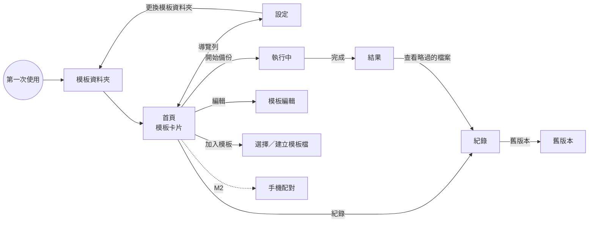

# UI 流程

**這一份是「畫面有哪些、按什麼會發生什麼」的權威。** 用語以 [用語表](glossary.md) 為準；
畫面上出現的每一個錯誤訊息都來自 [錯誤碼表](error-codes.md)，不在元件裡另寫。

## 原則

1. **主要動作一次點擊。** 首頁的每張模板卡片上就有「開始備份」，不必先進去再找按鈕。
2. **會刪、會搬、會覆蓋的動作，先說數量再做。**「這次會把 52 個檔案移到舊版本」，不是「確定嗎？」。
3. **按鈕寫動詞＋受詞。**「開始備份」「略過這些檔案」「重新指定模板檔」，不寫「確定」「是」「OK」。
4. **錯誤要給下一步。** 每一則錯誤下面就是建議動作；能做成按鈕的就做成按鈕。
5. **全部繁體中文**，包括日期（2026/10/23 下午 3:05）、大小（1.2 GB）、數字的千分位。
6. **不靠顏色單獨傳達狀態。** 「完成／有警告／失敗」同時有圖示與文字。

## 畫面

### 模板資料夾

新模板存放的地方，也是首頁的清單來源（ADR-0006 補充）。

- **第一次使用**（`settings.json` 沒有 `profilesFolder`）：開 app 先到這個畫面，選好才進首頁。
  預設 `文件\Nucifraga`；「選擇其他資料夾」可以改。資料夾不在就建
- **更換**：設定頁的「更換模板資料夾」。舊資料夾裡有模板時，多一個勾選「把現有的 {count} 份模板一起搬過去」（預設勾）。
  只搬第一層的 `*.json`；新資料夾已經有同名檔的**不覆蓋**、留在原處，各報一則 `APP-005`，畫面停在這裡讓使用者看完
- 首頁列出資料夾**第一層**的 `*.json`（依檔名排序），不另記清單；使用者自己丟進去的檔案也會出現。子資料夾不看
- 資料夾不見（碟沒接上、被搬走）：首頁與設定頁顯示 `APP-004`，外部模板照樣列出
- 備份進行中不能更換

### 首頁

- 每份模板一張卡片，**資訊表格式**（2026-10-23 使用者選定）：
  - 標題列：名稱（外部模板加標籤「外部模板」）、備份碟狀態（「● 備份碟已接上」／「○ 備份碟未接上」）、「開始備份」
  - 表格：來源（**每個來源一行、完整路徑**）、備份到、上次備份（時間＋結果；碟沒接上時寫「接上備份碟才看得到」）、模板檔
  - 底部一列：「編輯模板」「查看紀錄」「查看舊版本」（後兩個在碟沒接上時停用）
- 路徑一律等寬字、可換行，不截斷
- 碟沒接上時「開始備份」仍可按（按了會在預檢報 `DST-001`，並給「重試」）
- 模板檔讀不懂：顯示錯誤與檔案路徑。外部模板給「到設定處理」，資料夾裡的給「打開模板資料夾」
- 沒有任何模板時：一段說明。下方兩個按鈕「建立新模板」「加入現有的模板檔」一直都在

### 設定

導覽列（右上「首頁」「設定」）進入。三區：

- **模板資料夾**：路徑、「打開模板資料夾」「更換模板資料夾」
- **外部模板**：每份的名稱、路徑、讀不懂時標示；「重新指定模板檔」「從清單移除」（模板檔本身不刪）；「加入現有的模板檔」
- **關於與診斷**：版本、程式識別碼、設定檔位置、備用報告位置（備份碟找不到時寫的地方），各有「打開資料夾」

### 加入模板

- **加入現有的模板檔**：選一個 `.json`，成為外部模板。app 只記路徑（ADR-0006）。讀不懂就當場顯示 `CFG-*` 的訊息，不加入。
  選的檔案本來就在模板資料夾裡的話不另記
- **建立新模板**：不問存在哪裡，直接進模板編輯；按「建立模板」時存成 `<模板資料夾>\<名稱>.json`。
  檔名由名稱產生：Windows 不允許的字元換成 `_`、最多 60 字、保留的裝置名稱（`CON` 等）後面加 `_`；同名就加「 (2)」

### 模板編輯

| 區塊 | 內容 |
|---|---|
| 名稱 | 顯示名稱 |
| 來源資料夾 | 清單；每列可以改別名、移除；「加入資料夾」開資料夾選擇器 |
| 排除 | 「排除這些資料夾名稱」（`excludeDirNames`，標籤式輸入）、「排除這些檔案」（`excludeGlobs`） |
| 備份碟 | 目的地根；顯示這顆碟的檔案系統與剩餘空間 |
| 進階（預設收合） | 路徑過長時（警告／擋下）、傳完讀回驗證（開）、舊版本保留（永久／N 天）、永遠略過的被鎖檔案 |

儲存時**只改動過的欄位**寫回檔案，其餘位元組保留（data-model §1）。

- 每個區塊有標題、以分隔線分開
- **儲存列固定在視窗底部**：左邊是狀態（「● 有未儲存的修改」／「✔ 已儲存」／「沒有修改」／缺欄位的提示），右邊是「儲存模板」與「回到首頁」。
  沒有修改時「儲存模板」停用
- **未儲存的修改**（2026-10-23 使用者要求）：離開這個畫面（導覽列、標題、「回到首頁」）或關閉視窗時，若內容和載入時不同，
  先問「有未儲存的修改」—— 「儲存並離開」（存不成功就留在原畫面）、「不儲存，直接離開」、「繼續編輯」（焦點預設在這一個）。
  關視窗那一問的按鈕是「儲存並關閉」「不儲存，直接關閉」「繼續編輯」

### 執行中

- 上方：目前階段（預檢 → 掃描 → 比對 → 傳輸 → 收尾）的步驟條
- 中間：已處理／總數、已傳大小、目前檔案（路徑過長時截中間）
- 下方：「取消」。按下後顯示「做完目前這個檔案就停」，不立刻消失

**兩個會停下來問的時候**（state-machines §1）：

- **需確認**：「這次會把 {count} 個檔案移到舊版本（佔 {root} 的 {ratio}）。」＋前 20 筆路徑＋「確認並繼續」「取消這次備份」
- **需處理鎖定檔**：依程式分組 ——「Outlook（3 個檔案）」「sqlite3.exe（1 個檔案）」，每組可展開看路徑；
  按鈕「我關好了，重新檢查」「略過這些檔案」「取消這次備份」。勾選「以後都略過這些檔案」會寫進模板的 `alwaysSkipLocked`

### 結果

- 大圖示＋一句話：「備份完成」「備份完成，但有 3 個檔案沒備份到」「備份失敗：找不到備份碟」
- 數字：新增、更新、移到舊版本、略過、耗時
- 有 issue 時：依錯誤碼分組，每組顯示訊息＋建議動作＋「查看檔案」
- 「打開備份資料夾」「打開這次的報告」

### 紀錄

- 依時間列出每次執行（讀各目的地的 `_reports\`）；點進去就是那次的結果畫面

### 舊版本

- 列出 `_versions\` 底下每個時間點：檔案數、大小
- 「刪除這個時間點」→ 確認對話框寫出**完整路徑、檔案數、大小**，按鈕「永久刪除 {count} 個檔案（{size}）」
- 沒有「全部刪除」

## 無障礙與鍵盤

- 所有按鈕可用 Tab 到達、Enter 觸發；對話框開啟時焦點在「取消」那一側的按鈕
- 字級跟系統設定；最小寬度 800px 時不出現水平捲軸
